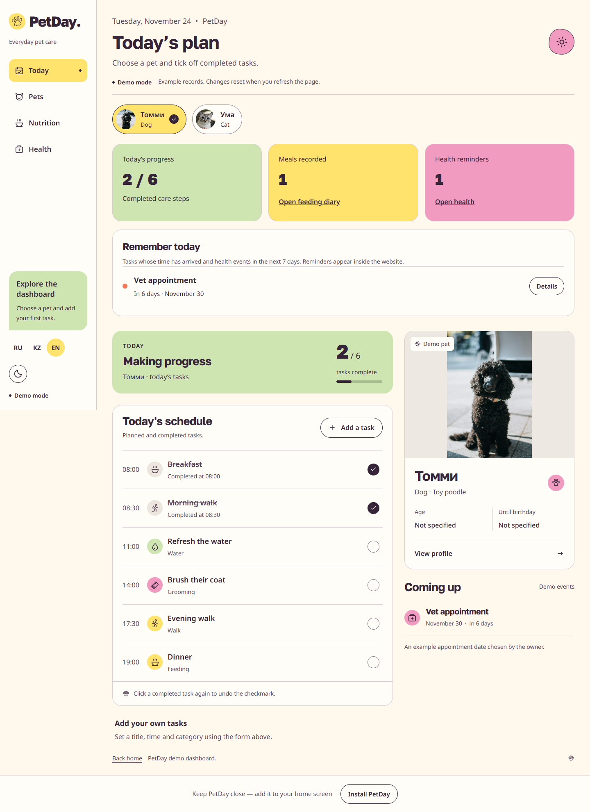
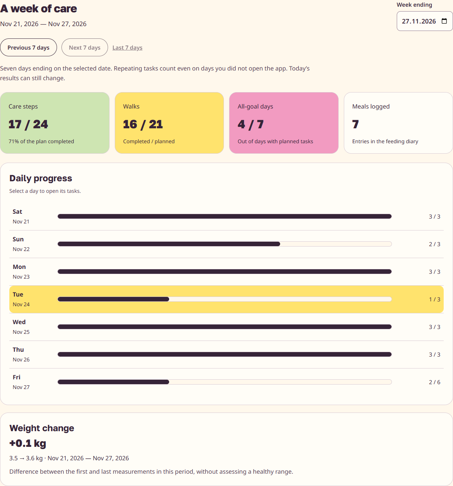
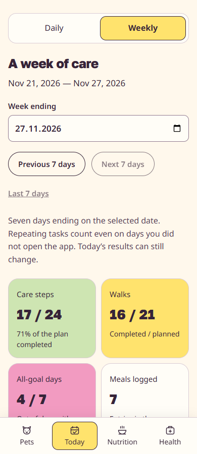
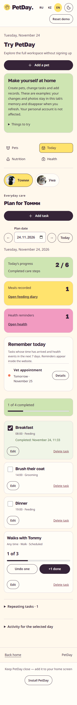

# PetDay

[](https://github.com/aishamussinaa/petday/actions/workflows/demo.yml?query=branch%3Amain)

[Live demo](https://petday-aisha-demo.dryduet3.chatgpt.site) · [Source code](https://github.com/aishamussinaa/petday)

A pet care web application built with **React, Node.js and PostgreSQL**. Keep pet profiles, daily routines, meals, veterinary records and weight measurements in one place.

**Portfolio project · actively developed.** The public demo runs without an account. The full application stores each user's data in a private local account.

## How it works

Tommy's routine is three walks a day. Open the interactive demo, switch to **EN** and select **Log a walk** on Tommy's card. [Try the demo](https://petday-aisha-demo.dryduet3.chatgpt.site/demo)

| Tommy's walks | Before | After one walk |
| --- | --- | --- |
| Today | 1 of 3 | **2 of 3** |
| Last 7 days | 16 of 21 | **17 of 21** |

Select **Open weekly report** to see where the 17 comes from. Tommy had 15 walks over the previous six days. Logging his second walk today brings the total to 17. His plan stays at 21 walks for the seven days.

PetDay updates the completed count on today's walking task. The demo keeps that task in browser memory, while a signed-in account saves it in PostgreSQL. Both use the same function to add up each day's completed and planned walks. [Weekly calculation](shared/weekly.js) · [Playwright test for Tommy's walk](tests/walk-tour.spec.js)



## Features

- **Pet profiles:** photos with crop and zoom controls, species, breed, birthday, allergies and notes.
- **Daily care:** one-off tasks, daily or weekly routines, and goals such as three walks a day. Track completion, undo a step and review activity history.
- **Event calendar:** browse vaccinations, veterinary visits, follow-up dates and annual birthdays across all pets. Select a month, day or pet, then open the original record.
- **Weekly overview:** a seven-day care summary per pet, including completed care steps, walks, days with all planned goals met, meal counts and weight change. Select any day to open its tasks. Unvisited repeating tasks count toward the plan; deleted instances stay excluded.
- **Mobile workspace:** fixed bottom navigation, compact demo guidance and large touch controls.
- **Undo deletion:** restore recently deleted tasks, meals, health records and weight measurements from the notification. Multiple deletions can be undone in reverse order during the current workspace session.
- **Quick actions:** log a walk or feeding with one tap, or enter a weight directly from Today. Walks advance the next unfinished walking goal when available.
- **Today overview:** completed care steps, recorded meals, and health reminders with direct links to the relevant sections.
- **In-app reminders:** unfinished tasks whose scheduled time has arrived, health plans and follow-up dates within seven days, and overdue dates that need checking.
- **Birthdays:** a seven-day countdown and an automatic cake celebration on the pet's birthday, respecting reduced-motion preferences.
- **Health journal:** vaccinations and veterinary visits, planned/completed status, clinic, vet, notes and optional follow-up dates.
- **Weight history:** dated measurements in kilograms, a trend chart, an accessible text list, editing and deletion.
- **Feeding diary:** food type, time, optional portion size and notes. Totals are calculated separately for grams, millilitres and pieces.
- **PDF export:** download a pet's profile, allergies, veterinary records and weight history. Cyrillic and Kazakh characters are supported through an embedded local font.
- **Light and dark themes:** a round moon/sun toggle, system preference detection and a saved preference shared across tabs.
- **Keyboard access:** Tab/Shift+Tab navigation, visible focus, skip links, Enter activation, and modal focus management with Escape support.
- **Three languages:** Russian, Kazakh and English; switching languages preserves form drafts.
- **Installable web app:** home-screen icons, a standalone window where supported, and a clear offline message with a retry action.

## Stack

| Layer | Technology |
| --- | --- |
| Frontend | React, Vite, JavaScript, CSS |
| Localization | i18next, react-i18next |
| API | Express 5, Node.js 24 |
| Database | PostgreSQL, Prisma |
| Authentication | Argon2id password hashing, database-backed sessions, HttpOnly cookies |
| Photos | Multer and Sharp; private owner-checked image routes |
| PDF | PDF-LIB, fontkit, embedded Noto Sans |
| Testing | Playwright with Chrome, Node.js test runner |

Dependencies use npm workspaces and pinned versions in `package-lock.json`.

## Run locally

Requirements: **Node.js 24**, npm, and PostgreSQL for accounts. The landing page and demo work without a database. Browser tests use an installed Google Chrome.

From the repository root in Windows PowerShell:

```powershell
npm.cmd ci
node scripts/setup-database.cjs
npm.cmd run db:generate
npm.cmd run db:migrate
npm.cmd run db:check
npm.cmd run dev
```

The setup script prompts for local PostgreSQL credentials and writes `.env`. It creates the `petday` and `petday_test` databases when needed without deleting existing data. Alternatively, use `.env.example` as a template and configure your own database URLs.

| Address | Purpose |
| --- | --- |
| `http://127.0.0.1:5173/` | Landing page |
| `http://127.0.0.1:5173/demo` | Interactive demo |
| `http://127.0.0.1:5173/app` | Personal account |
| `http://127.0.0.1:3001/api/health` | API health check |

Stop the development servers with **Ctrl+C**. After restarting your computer, run `npm.cmd run dev` again. GitHub stores the source code; it does not run the local application.

On macOS or Linux, use `npm` instead of `npm.cmd` for development/build commands. The current Playwright web-server command is configured for Windows.

### Environment

| Variable | Purpose |
| --- | --- |
| `DATABASE_URL` | PostgreSQL connection for the application |
| `TEST_DATABASE_URL` | Separate test database; its name must end in `_test` |
| `APP_ORIGIN` | Allowed frontend origins, comma-separated |
| `PORT` | API port, defaults to `3001` |
| `UPLOAD_DIR` | Optional private photo storage directory |
| `TRUST_PROXY` | Set to `1` only behind a trusted reverse proxy |

For a production account deployment, configure HTTPS, secure cookies, persistent PostgreSQL and private upload storage. The current API binds to loopback and needs an appropriate reverse proxy. The published portfolio build is a static demo, not the hosted account backend.

## Build and test

```powershell
npm.cmd run build
npm.cmd run build:demo
npm.cmd test
npm.cmd run test:unit
```

- `build` creates the full frontend in `client/dist`; it does not start the API.
- `build:demo` creates a standalone static demo in `client/dist-demo`, with registration/account routes mapped to the demo. No database or API is required.
- `test` runs the Playwright suite against separate servers on ports `3011` and `5183` and the guarded test database.
- `test:unit` checks validation, birthday calculations and PostgreSQL recovery behavior.

On every push, GitHub Actions builds the public demo and runs the desktop and mobile walk tests against that build. To reproduce the check locally with Chrome installed, run `npm run build:demo` followed by `npm run test:demo`.

Coverage includes data ownership, CSRF, validation, safe retries, concurrent edits, persistence, photo handling, daily goals, health and meal records, weight history, PDF download, themes, keyboard navigation, localization, responsive layouts and the offline fallback. Screenshots are written to the ignored `test-results/` directory. PDF output is also visually checked after rendering.

## Demo and data behavior

The public demo now uses the same workspace components and forms as the personal account. Without signing up, visitors can:

- Create, edit and delete pets; choose a photo and crop it entirely in the browser.
- Create one-off, daily and weekday tasks, track multi-step goals, undo completion and stop routines.
- Add, edit and delete meals, vaccinations, veterinary visits and weight measurements.
- Explore daily reminders, birthday countdowns and automatic celebrations, and download PDF reports.
- Switch languages and themes, navigate with the keyboard, and reset the demo after confirmation.

All example records are fictional. Unknown birthdays remain unknown until a visitor supplies one. Changes and selected photos live only in the current tab's memory: they survive navigation within the site, but reset on page reload. Tabs are independent. **Reset demo** restores the examples; cancelled resets keep the current data. Photos are cropped into temporary object URLs and are never uploaded.

The demo has a scoped in-memory transport with no fallback to the real API. It does not read or modify the signed-in user's account, cookies or database. The landing page's small interactive preview is independent of this full demo workspace. Authentication, server persistence and account settings belong to the full application rather than the sandbox.

The full application keeps profiles, tasks, meals, health records and weight measurements in PostgreSQL. Photos are stored separately in `server/uploads/pets` by default and are served only after an ownership check. Back up the database and uploaded photos together.

Writes require a valid session and CSRF token. Versions prevent silent overwrites from concurrent edits; stable client IDs make supported create operations safe to retry. Tasks and journal entries use soft deletion, while deleting a pet removes its related records.

Recurring tasks are generated when the selected date is opened. Stopping a routine preserves today's tasks and past history. Future tasks cannot be marked complete ahead of their date. Dates follow the browser's local calendar; February 29 birthdays use February 28 in non-leap years.

Health follow-up dates produce in-app reminders, not new medical records. Plans are not automatically marked completed. Feeding totals describe recorded portions, not recommended intake. Weight charts show measurements without judging a healthy range. PDF reports summarize owner-entered information and do not replace a veterinary passport.

## Installation and offline behavior

Use **Install PetDay** to open the browser's install prompt where available. Otherwise, the site provides instructions for Safari, Chrome and Edge. Installation on a public domain requires HTTPS, and available controls depend on the browser.

The service worker caches only a public offline message. It does **not** cache API responses, private photos or account data. An internet connection is required to load and save records. Background push notifications and full offline editing are not implemented.

## Project structure

```text
client/
  public/             Fonts, images, install icons, manifest and offline page
  src/
    account/          Personal account, daily care, health, food, weight and PDF
    components/       Shared controls, dialogs, icons and installation UI
    data/             Full demo store, workspace and landing preview data
    locales/          Russian, Kazakh and English translations
    Landing.jsx       Landing page
    App.jsx           Interactive landing-page preview
    main.jsx          Application entry point
server/
  prisma/             Schema and additive migrations
  src/                Express routes, validation, sessions and photo storage
shared/               Date-only weekly aggregation shared by API and demo
scripts/              Database setup, maintenance and public demo build
tests/                Browser, API and unit tests
docs/                 Screenshots and development notes
```

## Screenshots







## Assets and attribution

The interface uses local **Golos Text** and **Noto Sans** fonts under the SIL Open Font License. Their license files are included in `client/public/fonts`. The PDF font is Noto Sans; it is loaded only when exporting a report.

| Asset | Source |
| --- | --- |
| `poodle.jpg` | [Renate Dreyer on Unsplash](https://unsplash.com/photos/a-black-poodle-sitting-on-a-sidewalk-next-to-a-chair-kfxuGrYo0Bs), used under the [Unsplash License](https://unsplash.com/license) |
| `uma.jpg` | [User-supplied source](https://img-fotki.yandex.ru/get/3908/53643727.a/0_117993_1b5fd876_L.jpg); authorship and license have not been established, so no open license is claimed |
| `attached-poodle-cutout.png` | Project owner's supplied photograph, prepared as a transparent cutout |
| UI icons, decorative shapes and install icons | SVG artwork drawn in code for this project |

Demo photographs do not establish the appearance or medical history of a real user's pet. Images and fonts are served locally; normal browsing makes no requests to external photo or font services.

Technical references: [PDF-LIB font embedding](https://pdf-lib.js.org/docs/api/classes/pdfdocument#embedfont) and [PWA manifests](https://web.dev/learn/pwa/web-app-manifest).
